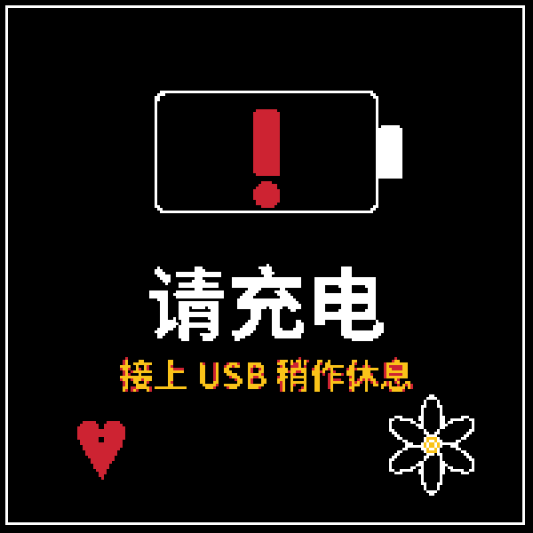

# molly-count

一块 ESP32-S3 四色墨水屏恋爱天数牌：每天早上 6:00 醒来一次，算出"我们在一起"的天数画到屏上，然后深睡。


固件为 PlatformIO + Arduino；早期 Rust/esp-hal 实现仅存于 git 历史。

## 硬件

微雪 [ESP32-S3-ePaper-1.54G](https://docs.waveshare.com/ESP32-S3-ePaper-1.54G)（ESP32-S3-PICO-1-N8R8，1.54" 红黄黑白四色墨水屏 200×200，板载 PCF85063 RTC / SHTC3 / ES8311 / 锂电充电）。

| 外设 | 引脚 |
|---|---|
| EPD 电源轨（低有效） | GPIO6 |
| EPD BUSY / RST / DC / CS | GPIO8 / 9 / 10 / 11 |
| EPD SCLK / MOSI（软件 SPI） | GPIO12 / 13 |
| RTC PCF85063（I2C0，地址 0x51） | SDA=47, SCL=48 |
| 电池电压（200K/200K 分压，VBAT=2×VADC） | GPIO4 |
| 绿色 LED（低有效） | GPIO3 |
| 音频电源（低有效，未用，睡前置高） | GPIO42 |
| 电池通路自锁（高有效，**勿拉低=关机**） | GPIO17 |
| 按键 BOOT / PWR（低有效，按下=接地） | GPIO0 / GPIO18 |

## 构建与烧录

```bash
nix develop                                        # devShell：platformio + python + 字体
nix develop -c pio run -d firmware                 # 编译
nix develop -c pio run -d firmware -t upload       # 烧录（真睡时连不上=正常；按住 BOOT 插 USB 进下载模式）
nix develop -c bash tools/run_host_tests.sh        # 宿主单测（纯逻辑）
nix develop -c python3 tools/prerender.py          # 改设计后重生成资产
```

- 首次 `pio run` 联网下载平台工具链到 `~/.platformio`（约 1.5GB）。
- 真睡时 USB 设备消失、esptool 连不上是正常的；清醒窗口只有 ~15s 控制台 +
  ~20s 刷屏，可挂机 `bash tools/flash_watch.sh`（端口出现 0.3s 内自动烧录）。
- `prerender.py` 生成固件编译输入 `firmware/src/assets.h/.cpp`（`assets/*.2bpp`
  为中间产物，不入库）。`MOLLY_ANNIV=Y.M.D` 本机渲染真实日期预览（勿提交），
  `MOLLY_FONT` 指定非 nix 环境的字体路径。数字区最多 3 位。

## 串口控制台

上电后 15 秒内连 USB-CDC（115200）。主机→设备写入需 DTR 断言，
`python3 tools/serial_cmd.py --send GET` 已内置：

| 命令 | 作用 |
|---|---|
| `SETDATE y-m-d h:m:s` | 设置 RTC |
| `SETANNIV y-m-d` | 设置纪念日（持久化到 flash 0xC000） |
| `GET` | 读回纪念日 / 天数 / 电池电压 / 唤醒证据 |
| `SLEEP <秒>` | 指定秒后唤醒（测试定时唤醒） |
| `BATTTEST LOW\|CRIT` | 演示低电/危急画面（不持久化） |
| `BTN` | 读回两个按键电平 |
| `WIFI` / `SETWIFI ssid pass` / `FORGETWIFI` | 查看/设置/清除 WiFi 凭证 |
| `SETNTP <host>` | 设置 NTP 服务器（默认 ntp.aliyun.com） |
| `SETOTAURL <url>` | 设置 OTA 基地址，留空禁用 |
| `FORCEOTA` | 本轮唤醒强制检查 OTA（需电池 ≥3.6V） |

按键手势：

| 手势 | 效果 |
|---|---|
| 点按 BOOT | 唤醒 |
| 清醒期长按 BOOT ≥5s | 重开配网热点 |
| 清醒期长按 PWR ≥5s | 驻留刷机模式（LED 常亮、串口在线 30 分钟，可任意烧录） |
| 复位时按住 BOOT | 下载模式（硬件兜底） |

没电池只插 USB 时 PWR 长按无效（高电平来自电池；配网在 BOOT 上，不受影响）。

## 运行模型

```
06:00 定时唤醒 → 15s 控制台窗口 → 读 RTC → 算天数 + 采样电池
  → 强制全刷（~15-20s）→ 写 flash → 深睡到明早 06:00
```

- 日期读 PCF85063（跨深睡走时）；天数 = 纪念日起算、当天记第 1 天。
- 任意唤醒后强制全刷一次；电池在位时插拔 USB 不复位、不唤醒。
- 电池阈值（`firmware/src/battery.h`，带滞后）：<3550mV 低电、<3350mV 充电警示，
  恢复需 >3750/3450mV。
- flash 记录在 0xC000（32 字节），分区表刻意不认领 0xC000-0xE000：重复烧录不清
  记录，`erase_flash` 会。
- 深睡前 GPIO3/6/17/42 全部 pad-hold（GPIO17 悬空 = 电池自锁断开 = 睡眠中掉电）。
- 唤醒源：BOOT（ext0）+ 06:00 定时器；PWR 仅开机与运行时手势。
- LED：灭=睡眠、慢闪=醒着/连网、快闪=刷屏、三连闪=配网等待、常亮=驻留刷机。

## 设计与资产

| 正常 | 低电 | 充电 |
|---|---|---|
|  |  |  |

预渲染背景 + 运行时叠加文字与数字；几何常量由 `tools/prerender.py` 单一来源生成。

移植溯源（`reference/` 不入库）：面板驱动与原理图见微雪
[产品文档](https://docs.waveshare.com/ESP32-S3-ePaper-1.54G)（Resources 区）与
[官方 demo 仓库](https://github.com/waveshareteam/ESP32-S3-ePaper-1.54G)；
电源 BSP（yunliao-s3 例程）与设计参考图无公开链接。
